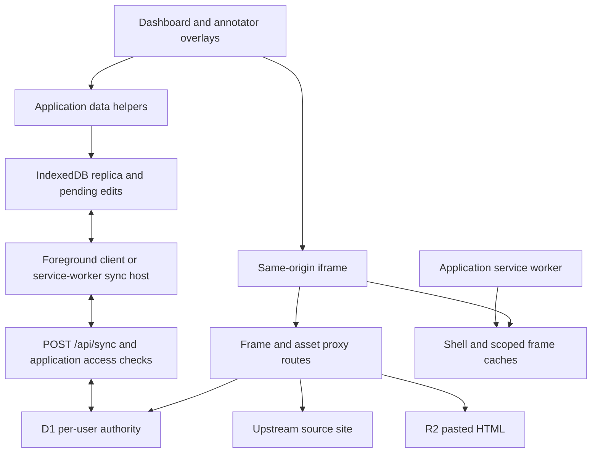

# Architecture

Status: Current implementation. Reviewed: 2026-10-18.

Annotation Studio combines an account's local record replica with an app-owned
copy of a source page's DOM. Requirements define the [observable contract](requirements/README.md);
[ADRs](adr/README.md) explain the choices and tradeoffs.

## Ownership

| Boundary | Responsibility | Entry points |
| --- | --- | --- |
| App shell and dashboard | Account UI, saved pages, search, notes, palette, navigation | [Layout](../app/layout.tsx), [dashboard](../components/Dashboard.tsx) |
| Annotator UI | Frame composition, selection/highlight controls, dialogs, panel state | [Annotator](../components/Annotator.tsx), [data context](../components/Annotator.context.tsx), [overlay context](../components/AnnotatorOverlay.context.tsx) |
| Annotation session | Frame preparation, title/mode/link handling, anchor matching and DOM highlights | [Session](../core/annotation/session/useAnnotationSession.ts), [DOM helpers](../core/annotation/dom/dom.ts), [matcher](../core/annotation/model/index.ts) |
| Application persistence | Typed asynchronous record access, normalization, account recovery and lifecycle | [Data helpers](../core/persistence/syncData.ts), [provider](../core/persistence/syncRuntime.tsx), [lifecycle](../core/persistence/syncClientLifecycle.ts) |
| Shared sync contract | Collections, primary keys, indexes, generated model/client/server wiring | [Configuration](../sync-engine.config.ts), [client hooks](../sync/client.ts), [server hooks](../sync/server.ts) |
| Source-page transport | Resolve saved origins, fetch/rewrite documents/assets, load pasted copies | [Frame route](../app/frame/[site]/[[...path]]/route.ts), [asset route](../app/proxy/[site]/[[...path]]/route.ts), [middleware](../proxy.ts) |
| Browser worker | Workbox caches, scoped frame bundles, composable sync host | [Service worker](../public/sw.js), [registration](../components/ServiceWorkerRegister.tsx), [build](../vite.config.ts) |
| Cloudflare runtime | Vinext routing, bindings, image optimization, D1 and R2 | [Worker](../worker/index.ts), [Wrangler configuration](../wrangler.jsonc) |

Annotation data state follows replica changes. Overlay state follows local
interactions such as selecting text or opening a dialog; it is held separately.

## Opening a page

1. The dashboard normalizes the URL, ensures a local page and website row, and
   requests sync for newly created rows. Website IDs are route slugs; the stored origin is used to
   reconstruct upstream URLs.
2. Before navigation, `ensureWebsiteAvailableForRoute()` checks that the server
   can read the matching website. This bridges local persistence and a route
   that resolves its origin from confirmed D1 state.
3. `/{site}/{path...}` resolves the current account's website, validates the
   path/origin, and passes the canonical page URL and scoped `/frame/...` URL to
   `SitePageClient`. The client ensures a local page row before mounting the
   annotator.
4. The frame route prefers the user's stored R2 copy, otherwise fetching the
   source. It rewrites supported same-origin assets through `/proxy/...`.
   Source redirects and `<base>` affect relative URL resolution.
5. The session prepares the iframe document, reads titles and selections, and
   reapplies saved highlights from quote/context anchors. Injected highlight
   spans are presentation state.

The same-origin frame enables `iframe.contentDocument` access for DOM ranges,
highlight wrapping, and geometry. It also places fetched source scripts inside
the app origin; it is not an isolation boundary. Pasted HTML receives additional
script-disabling transforms. See [ADR-0001](adr/0001-same-origin-frame-proxy.md)
and [ADR-0003](adr/0003-pasted-html-fallback.md).

## Saving and delivering edits

1. UI code calls application helpers. Typed collection mutations are awaited for
   local persistence before being treated as saved locally.
2. Reads include optimistic local work. Helpers schedule delivery in the
   background, await a sync run where needed, or explicitly defer a flush.
3. The foreground client or application service worker opens the same account
   replica and sends bounded exchanges to `POST /api/sync`.
4. Application hooks check cookie identity, request Origin/Fetch Metadata, and
   stream access. The generated D1 authority validates and decides CRUD changes,
   storing confirmed per-stream rows with canonical history and decisions.
5. Reconciliation updates the replica. React hooks reread records on revision
   changes. Server routes read confirmed materialized records through the D1
   adapter rather than reading browser storage.

The app persists quote/context fields, not durable DOM paths or numeric offsets.
Field patches preserve unrelated concurrent edits; same-field changes follow
authority order. See [ADR-0002](adr/0002-quote-based-annotation-anchors.md) and
[ADR-0005](adr/0005-schema-driven-local-first-sync.md).

## Identity and offline scope

The provider retains the last server-verified account selector for offline
recovery of an existing replica. It is not proof of server authorization. The
current auth implementation remains a simple user-ID cookie and password hashes;
the sync rewrite does not introduce signed sessions. Lifecycle code serializes
replica opening, closing, and account changes. Logout retains local work.
See [ADR-0006](adr/0006-verified-account-offline-recovery.md).

Record durability and page caching are separate. IndexedDB holds records and
pending operations. Cache Storage holds shell/build resources and observed frame
documents/assets; R2 holds pasted source copies on the server. Cached page
coverage depends on successful prior loading and available assets. Background
execution depends on browser scheduling, with foreground fallback. The app owns
its Workbox worker; the sync package's generated offline shell is not enabled.
See [ADR-0004](adr/0004-frame-cache-partitioning.md).

## Runtime, generation, and upgrade

Vinext serves the Next-style App Router on a Cloudflare Worker. The entry point
exposes bindings through `getEnv()` and handles image optimization before
delegating routing. `DB` stores auth and sync state, `WEBPAGES_BUCKET` stores
pasted HTML, `ASSETS` serves the client build, and `IMAGES` provides image
transformation.

`sync-engine.config.ts` is the authored logical schema. Generated sync modules
and the POST route are regenerated rather than edited. Client/server hooks,
`public/sw.js`, and reviewed migrations remain application-owned. Generation
never applies SQL. See [development](development.md) and the
[data model](reference/data-model.md).

Upgrade imports retained old per-stream canonical history into the new
authority; it does not migrate an old browser outbox or infer ownership from
legacy global tables. Stop old writers before cutover and follow the
[upgrade procedure](operations/sync-upgrade.md), as recorded in
[ADR-0007](adr/0007-canonical-log-upgrade.md).
